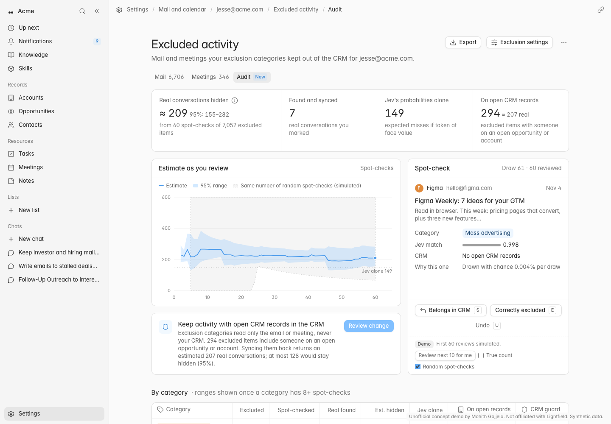

# Exclusion audit for Lightfield

**Live demo:** https://mohith26.github.io/lightfield-exclusion-audit/

Lightfield's exclusion categories (Oct 23, 2026 changelog) use Jev to keep cold pitches, newsletters, personal mail, investor and hiring threads out of the CRM. The docs say the defaults are "written to match only clear cases, so it's unlikely to hide a real conversation", but nothing measures *how* unlikely. This demo adds an **Audit** tab next to Mail and Meetings in *See excluded activity*: it asks you to spot-check a handful of excluded items, picked by a sampling design, and turns those answers into an estimate with a 95% interval of how many real customer conversations your categories are hiding. It then proposes one concrete fix, a **CRM guard** that syncs back excluded activity when someone on the thread is on an open opportunity or account (categories never look at the CRM today), and shows what that fix would return before you apply it.



*Unofficial concept demo by Mohith Gajjela. Not affiliated with Lightfield. Synthetic data.*

## Results (synthetic 90-day mailbox, `data/results.json`)

7,052 excluded emails and meetings for `jesse@acme.com`; 243 of them are real customer conversations (investor intros to buyers, signed DocuSign order forms, a customer's counsel redlining the MSA, a champion writing from Gmail, customer-hosted dinners, partner pitches, trial signups from target accounts).

| After 60 spot-checks | Estimate | 95% interval | Width |
|---|---|---|---|
| **This audit** (active sampling + prediction-powered inference) | 209 | **155 to 282** | 127 |
| Same number of random spot-checks (Wilson) | 235 | 65 to 801 | 737 |
| Jev's probabilities taken at face value | 149 | none | |
| Truth | **243** | | |

| Coverage of the 95% interval (1,000 simulated audits each) | 30 checks | 60 checks | 100 checks |
|---|---|---|---|
| This audit, shipped mailbox | 96.6% | 96.2% | 97.1% |
| Mean width, this audit vs random | 353 vs 1,106 | 177 vs 723 | 138 vs 539 |
| 40 other mailboxes with a drifted mix (50 audits each) | | 92.5% | 93.7% (at 120) |

CRM guard: 294 excluded items include someone on an open record; syncing them back returns 217 real conversations (the audit estimates 207 from the same 60 spot-checks) and leaves 26 hidden. The page reports what stays hidden as an upper bound (here at most 128), because that pool is mostly unseen by 60 draws.

## How it works

1. **Audit prior.** Every excluded item gets a prediction `f_i` that it is a real conversation: a small logistic calibrator on top of Jev's match probability, plus whether any participant is on an open CRM record, plus the category. It is trained on a *separate* history of "Sync anyway" decisions from another (deliberately drifted) workspace, never on this audit's labels.
2. **Sampling design.** Spot-checks are drawn with replacement with probability `pi_i ∝ 0.8 · sqrt(f_i(1−f_i)) / Σ + 0.2 / N`, the variance-minimising shape from Zrnic and Candès (2024) with a uniform floor so every item can be drawn. The UI shows each draw's probability. Repeat draws reuse the earlier answer, so they cost nothing.
3. **Estimator.** Prediction-powered inference (Angelopoulos et al., 2023) with Hansen-Hurwitz weights: `M̂ = Σ f_i + (1/n) Σ_j (y_j − f_j) / pi_j`. This is unbiased for the true hidden count whatever `f` is. A confidently wrong Jev (investor intros score about 0.94 "investor conversation") costs interval width, never bias. The interval is built on the log scale because the rectified mean is right-skewed.
4. **Fix.** The CRM guard returns `crm = 1` items per category through the same *Apply changes (n)* confirm flow the settings page already uses. The estimate of real conversations among them uses the same labels. "Still hidden" is reported as `total.hi − guarded.lo − known positives`, a union-bound upper bound (98.7-99.8% coverage in simulation).

Every number on the page is computed in the browser by `src/audit.js` from `data/mailbox.json` and `data/prior.json`. `scripts/evaluate.mjs` runs the same functions to write `data/results.json`, and a test checks that they agree.

## The app

- **Audit** (`#/excluded/audit`): estimate, interval and how they narrowed as you reviewed. Includes a spot-check card (`S` belongs in CRM, `E` correctly excluded, `U` undo), the CRM-guard recommendation and a per-category table.
- **Category drill-down** (`#/excluded/audit/category/legal`): Jev-probability histogram by review status and items ranked by audit prior, with *Sync anyway* in the row menu.
- **Mail / Meetings** (`#/excluded/mail?cat=legal`): the excluded-activity lists with category filter and search.
- **Settings** (`#/settings`): Mail and calendar account page with *Excluded activity types*, a per-category "Keep open CRM records" switch, and *Apply changes (n)* with a confirm summary.
- State (reviews, applied changes) persists in `localStorage`. *Export* writes the audit table as CSV, and the `…` menu exports raw spot-checks as JSON. The first 60 reviews are pre-filled by a simulated reviewer so the page opens on a finished audit; `…` → *Reset audit* starts from zero. The *Demo* row can show the true count and the random-spot-check baseline, both of which only exist because the data is synthetic.

Design tokens (InterVariable at weight 425, the neutral and blue oklch scales, radii and shadows) are copied from Lightfield's production CSS. Icons are Lucide.

## Run it

```bash
node scripts/generate.mjs   # data/mailbox.json + data/prior.json (seeded)
node scripts/evaluate.mjs   # data/results.json (headline + coverage study)
node --test test/           # 15 tests
python3 -m http.server      # then open http://localhost:8000
```

No build step and no dependencies. Node 20+ for the scripts and tests.

## Honest limitations

- **Synthetic data.** The mailbox, subtypes and Jev probabilities are simulated. The failure modes are realistic, but their rates are my guesses, not Lightfield data.
- **Asymptotic interval.** PPI's interval is a CLT interval. It held 95-97% coverage on the shipped mailbox, but only 92.5% on average (worst mailbox 86%) across 40 drifted mailboxes at 60 checks. Misses come from rare real conversations the prior rates as very unlikely; more checks help (93.7% at 120). A finite-sample bound (betting confidence sequences) is valid, but with importance weights it is far too wide to be useful at this sample size.
- **Per-category ranges** are shown only once a category has 8+ spot-checks. Below that, coverage in small categories ran 75-98%.
- **The prior's history** is simulated as another workspace's Sync-anyway decisions. Real override logs are selection-biased (people only review some items). That only affects the prior's quality, not the estimator's unbiasedness.
- **Reviews must be done in order.** Skipping a draw you don't like would bias the estimate, so the UI has no skip.
- **Settings shell.** The Settings sidebar layout isn't public, so the page keeps the main app sidebar with a Settings entry.

## Novelty

I checked Lightfield's changelog (Jan to Nov 2026), help center (exclusion categories, Mail and Calendar, For review), the Jev/TypeSafe docs (confidence, probability routing) and Ves Stoyanov's Oct 7 post on agent-built classifiers. Exclusion categories show *what* was excluded and allow *Sync anyway*, but nothing estimates how much real activity is hidden, and categories don't read the CRM. HubSpot's "never log" lists, Salesforce Einstein Activity Capture exclusions and Attio's sync filters are rule lists with no measurement. PPI and active statistical inference are published methods. Applying them to auditing a CRM's auto-exclusion classifier, with a CRM-aware prior and a guard rule evaluated on the same labels, is new as far as I can find.

References: Angelopoulos, Bates, Fannjiang, Jordan, Zrnic, "Prediction-powered inference", *Science* 2023. Zrnic and Candès, "Active statistical inference", ICML 2024. Hansen and Hurwitz, 1943.
